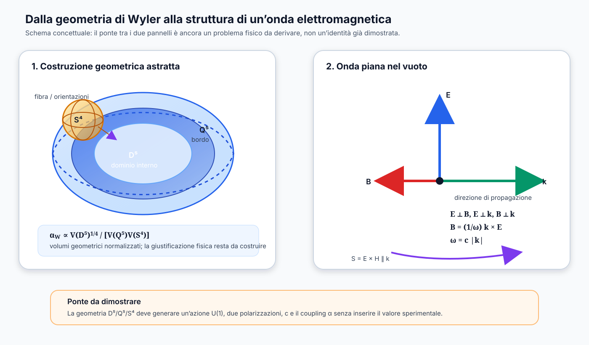

# Wyler neighbourhood protocol

Status: `STAGE_W1_COMPLETE` after explicit authorization on 14 November 2026.

## Purpose

This pilot starts from the historical Wyler expression and explores a finite,
pre-registered normalization neighbourhood. It is deliberately split into an
exact historical anchor and diagnostic stress tests. The stress tests are not
treated as physical theories unless an independent derivation supplies their
normalization.

## Visual map



The left panel is a human-readable projection of the abstract domains; the
right panel is the local Maxwell plane-wave geometry. The bridge between them
is precisely the part that still requires a physical derivation.

## Historical anchor

The anchor is:

```text
alpha_W = 9/(16*pi^3) * (pi/5!)^(1/4)
```

equivalently:

```text
alpha_W = 9/(8*pi^4) * (pi^5/(2^4*5!))^(1/4)
```

It uses the unit Lie-ball volume `V(D5)`, its boundary volume `V(Q5)` and the
unit `S4` volume. The historical numerical value is recorded without fitting.

## Pre-registered neighbourhood

The diagnostic grammar varies only three discrete ingredients:

- spin multiplicity: `1`, `2`, `4`;
- phase factor: `1`, `2*pi`;
- exponent of `V(D5)`: `1/8`, `1/4`, `1/2`.

This creates 18 records. The exact Wyler combination occurs once. The other 17
records are retained to expose sensitivity to normalization choices; they are
not alternative physical derivations.

The CODATA target is read only after the 18 records have been generated. The
comparison is therefore post-generation and target-blind during generation,
but it is an empirical numerical comparison and is recorded as such.

## Hard interpretation rules

- A close value is not a physical pass.
- A factor chosen after seeing the target is calibration, not derivation.
- A free radius or measure normalization must be derived or marked unresolved.
- The pure geometric expression does not yet establish a Maxwell/QED action.
- A physical candidate must recover gauge invariance, the transverse photon
  sector, charged matter, quantization and an independent observable.
- No candidate is selected or ranked automatically.

## Decision gate

The pilot can establish only that the historical number is reproducible and
that nearby normalization conventions are numerically sensitive. The next
physical gate is an explicit `U(1)` action and a derivation of its coupling.
If that cannot be supplied without inserting the desired value, the Wyler
construction remains a numerical/geometric coincidence rather than a theory.
